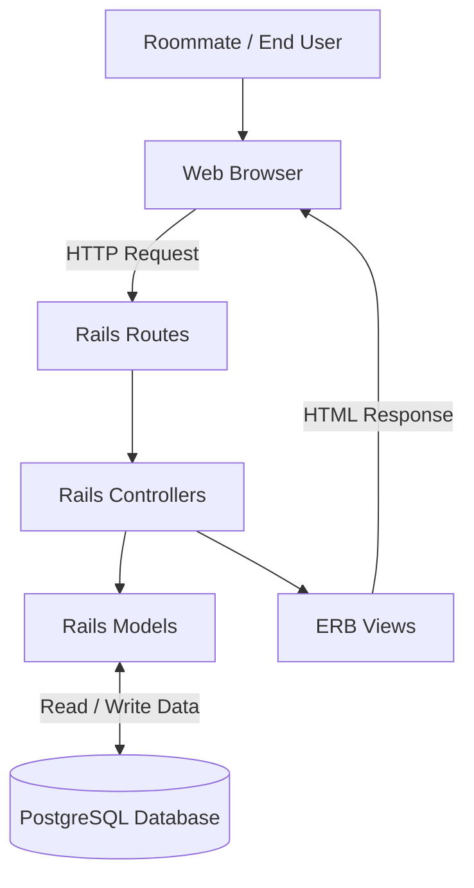
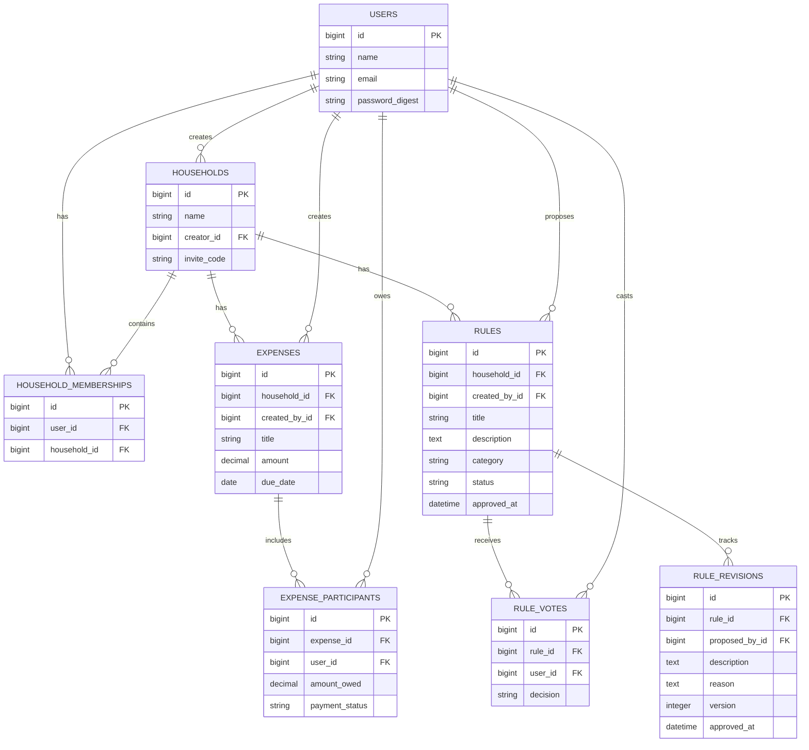

# RoomateOS

## Technical Documentation

### Prerequisites

Before setting up Roommate OS, ensure the following
are installed:

- Git
- Ruby 3.4.10
- Bundler
- PostgreSQL

### Clone the Repository

Clone the project from GitHub:

```bash
git clone https://github.com/tamu-edu-students/team-water-final-project-Fall-2026-CSCE-606.git
```

Navigate to the project directory:

```bash
cd team-water-final-project-Fall-2026-CSCE-606
```

### Install Dependencies

```bash
bundle install
```

### Database Setup

Ensure PostgreSQL is running and the local
database user has permission to create databases.

Prepare the development database:

```bash
bin/rails db:prepare
```

### Start the Application

```bash
bin/rails server
```

Open http://localhost:3000 in a browser.

### Run Automated Tests

RSpec:

```bash
bundle exec rspec
```

Cucumber:

```bash
bundle exec cucumber --publish-quiet
```

Combined coverage report:

```bash
bundle exec ruby script/coverage_report.rb
```

### Architecture

### System Architecture Diagram

Roommate OS follows the Model-View-Controller (MVC)
architecture using Ruby on Rails and PostgreSQL.



**Architecture Components:**

- **Browser:** Allows users to interact with Roommate OS.
- **Routes:** Direct incoming requests to controllers.
- **Controllers:** Handle requests, authentication,
  authorization, and application workflows.
- **Models:** Implement business logic and data validation.
- **PostgreSQL:** Stores application data persistently.
- **ERB Views:** Render HTML pages for users.

### Database Relationship Diagram

The application uses PostgreSQL with the following
database relationships.



**Key Relationships:**

- A user can create multiple households.
- A user can belong to multiple households.
- Each household can have multiple members.
- A household can contain multiple expenses.
- An expense can have multiple participants.
- Each expense participant records an amount owed
  and payment status.
- A household can contain multiple house rules and agreements.
- Household members can vote on proposed rules with a majority threshold.
- Approved rules support amendments and maintain a complete revision history.

### Production Deployment

**Status:** Planning — Hosting platform not yet finalized.
Roommate OS will be deployed as a cloud-hosted Ruby on Rails application using PostgreSQL.
The team is currently evaluating the following hosting options:

- **Microsoft Azure for Students** — $100 student credit.
- **Heroku** — Rails-friendly hosting with PostgreSQL support.
- **Render + PostgreSQL** — Cloud hosting with GitHub integration.

The final platform will be selected based on cost, ease of deployment, and database support.
Once finalized, detailed deployment instructions and the production URL will be added to this section.

## User Guide

### 1. Register and Log In
- Open the Roommate OS application.
- Create an account using your name, email, and password.
- Log in using your registered credentials.

### 2. Create or Join a Household
- Create a new household by entering a household name.
- Share the generated invitation code with roommates.
- Existing users can join a household using a valid invitation code.
- View your household and its members.

### 3. Household Dashboard
- Select a household to view its dashboard.
- View household members and expense summaries.
- Navigate to available household features.

### 4. Manage Shared Expenses
- Add a new expense with its amount and details.
- Split expenses equally or using custom percentages.
- View individual balances and outstanding payments.
- Mark your own share as paid.
- View and manage household expenses.

### 5. Household Rules and Agreements
- View prominently displayed approved house rules.
- Propose new rules and agreements with categories.
- Vote to approve or reject open proposals with democratic majority threshold.
- Propose amendments to existing rules.
- View full revision and amendment history.

### 6. Log Out
- Use the logout option to securely end your session.

### Upcoming Features
Additional features such as chore management
and inventory tracking are planned for future integration.

## Current Implementation

Roommate OS is a web-based application designed to help roommates
manage their shared household responsibilities.

The application is being developed using Ruby on Rails and PostgreSQL.

### Implemented Features

#### User Authentication
- User registration with name, email, and password
- Secure password hashing using bcrypt
- User login and logout
- Session-based authentication
- Protected pages accessible only to authenticated users

#### Household Management
- Create a household with a custom name
- Automatically add the creator as a household member
- View households associated with the logged-in user
- View household details and members
- Restrict household access to authorized members

#### Household Invitations
- Generate a unique invitation code for each household
- Allow existing members to share invitation codes
- Join a household using a valid code
- Prevent duplicate household memberships
- Display appropriate errors for invalid invitation codes

#### Household Rules & Agreements
- Propose new rules and agreements by any household member
- Voting mechanism with majority threshold calculation
- Automatic status transitions (`proposed` -> `approved` or `rejected`)
- Prominent display of active approved house rules
- Amendment process for approved agreements
- Full version tracking and revision history log

### Household Roles and Permissions

Roommate OS supports two household roles: **Admin** and **Member**.

- The user who creates a household is assigned the Admin role.
- Users who join an existing household are assigned the Member role by default.
- Household members can access their own household's features, subject to feature-specific permissions.
- Admins can edit and delete chores created by any household member.
- Regular members can edit and delete chores they created themselves.
- All household members can create chores and assign them to household members.

These role-based chore permissions are part of the calendar and chore management integration.

### Technology Stack

- Ruby 3.4.10
- Ruby on Rails 8.1.4
- PostgreSQL
- RSpec for automated model and request testing
- Cucumber for acceptance testing
- SimpleCov for code coverage

### Running the Application

Install dependencies:

```bash
bundle install
```

Prepare the database:

```bash
bin/rails db:prepare
```

Start the Rails server:

```bash
bin/rails server
```

Open http://localhost:3000.

### Running Tests

Run the RSpec suite:

```bash
bundle exec rspec
```

Run the Cucumber acceptance tests:

```bash
bundle exec cucumber --publish-quiet
```

RSpec coverage reports are generated under `coverage/`.

### Current Development Status

US01 — Household Creation & Invitations has been implemented
and verified through automated and manual testing.

The US08 dashboard foundation provides a household selector after login and a
member-only overview at `/households/:household_id/dashboard`. It displays the
household's actual members. With the US02 integration in this branch, Bills &
balances shows real pending shares, net amounts, due-soon/overdue bills, and
payment actions. A zero net amount does not mean unpaid shares are settled.
Chores, inventory, and voting remain pending on this branch.
See [the US08 guide](docs/us08/us08-dashboard.md) for the user guide,
integration checklist, architecture, and remaining delivery requirements.

RSpec and Cucumber produce separate reports at `coverage/rspec/index.html`
and `coverage/cucumber/index.html`. After running both suites, generate the
combined report with `bundle exec ruby script/coverage_report.rb`.
