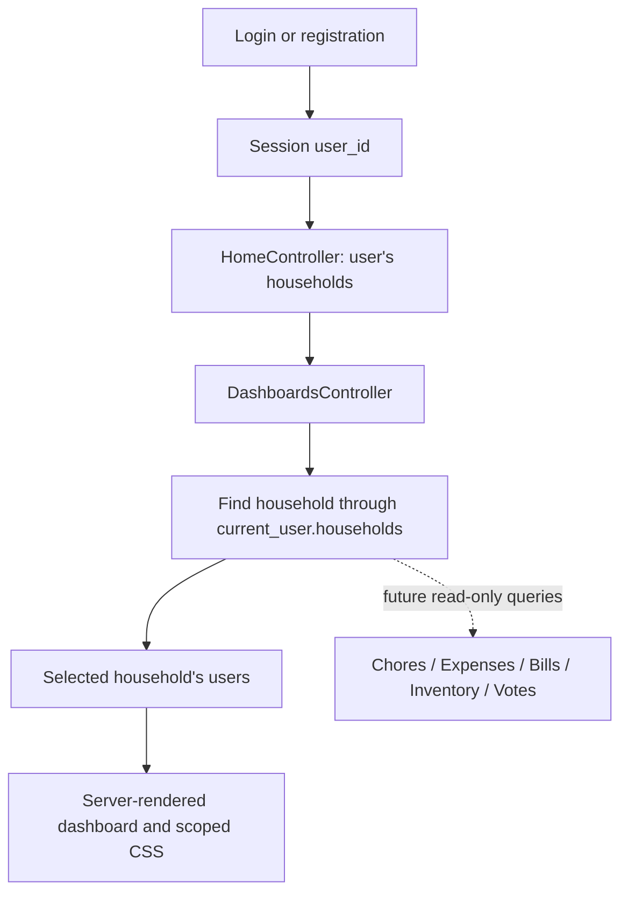

# US08 Household Dashboard

Bhaumik Patel owns US08. This increment connects the merged US01 authentication
and household membership code to a responsive dashboard. It provides an entry
point for the remaining household modules. Live chores, bills and balances,
inventory alerts, and voting summaries are still pending integration; this is
not the completed US08 story or a production release.

The baseline inspected was `main` at `68d3294`. Work is on
`feature/us08-household-dashboard`. The proposal's US08 maps to `US-008` in
`docs/user_stories.md`, issue [#7](https://github.com/tamu-edu-students/team-water-final-project-Fall-2026-CSCE-606/issues/7),
and issue [#17](https://github.com/tamu-edu-students/team-water-final-project-Fall-2026-CSCE-606/issues/17).
Other story numbers in the original repository document differ from the team's
six assigned stories; match by title when coordinating work.

## Implemented foundation

- Login continues to store `session[:user_id]` and redirect to `/`.
- The home page lists only households the current user belongs to.
- A user without memberships gets working create and join links.
- `/households/:household_id/dashboard` shows the selected household and its members.
- Unauthenticated requests redirect to login. Unknown households, non-members,
  and former members receive the same generic 404 response.
- The dashboard links to existing household details and invitations. Those pages
  also link back to the dashboard.
- Four visible sections reserve space for chores, bills/balances, inventory, and
  voting. Each says "Not available yet" until its real integration is added.
- The interface is server rendered, with keyboard focus indicators, a skip link,
  labelled regions, escaped names, and a one-column layout below 640 CSS pixels.
- No migrations, domain models, payment calculations, calendar behavior, or role
  permissions were added in this increment.

## User guide

1. Sign up or log in using the existing authentication pages.
2. On the home page, create a household or join one with an invitation code if
   you do not already belong to one.
3. Choose your household's name to open its dashboard. After creating or joining
   a household, use **Open household dashboard** on the details page.
4. View **Your roommates** to see the current membership. Use **Household details
   & invitations** to access the existing invitation workflow.
5. Use **Your households** to select another household, or **My Households** to
   manage households through existing pages.
6. Use **Log Out** to end your session.

"Not available yet" does not mean there are no tasks or no money owed. These
sections do not yet read the corresponding modules. Once integrated, zero-data
states will explicitly say there are no matching items.

## Architecture



`DashboardsController` performs the membership-scoped lookup before reading
member data. Future queries must start from this authorized `@household`, rather
than a global model lookup or a user ID supplied in request parameters. The
dashboard should read module-owned data and link to module-owned forms. It should
not create duplicate tables or implement split, recurrence, or voting rules.

The global layout change only declares the page language. Dashboard styles are
scoped to `.dashboard-shell` to avoid restyling teammates' forms. Small RuboCop
cleanup outside dashboard files corrects whitespace and missing final newlines.

## Integration checklist

These are dashboard requirements to confirm with the module owners, not claims
that these schemas or endpoints are already implemented on `main`.

| Dependency | Observed state | Information needed by US08 |
| --- | --- | --- |
| US01 authentication and households | Merged; user ID in session; membership-based access; no roles in current schema | Preserve the session and membership interfaces. Dashboard remains readable by all household members. |
| US02 shared expenses | Code on `origin/us02-shared-expense-management`, not in inspected `main` | `household.expenses`, participant user, `amount_owed`, `payment_status`; household expense and balance route helpers. |
| Bills and due dates | No Bill model in inspected `main` | Confirm bill owner, due date, user's unpaid share, paid-state semantics, and destination route. Expenses currently have `expense_date`, which is not a bill due date. |
| US04 chores | Branch exists, but no Chore model in inspected branch | Confirm household scope, title, assignee, due date, completion values, recurrence ownership, and destination route. |
| US06 inventory | No InventoryItem model in inspected `main` | Confirm quantity, units, low-stock threshold, household scope, and inventory/shopping route. |
| US09 rules and voting | No rules/votes model in inspected `main` | Confirm open/closed status, deadline/time zone, how to identify an existing vote by the current user, and voting route. |
| Shared calendar | Open [PR #27](https://github.com/tamu-edu-students/team-water-final-project-Fall-2026-CSCE-606/pull/27) | Confirm final API in the calendar owner's docs and authorization policy after review. Calendar is optional for the initial dashboard. |

The expense branch currently defines `ExpenseParticipant` states `pending` and
`paid`. After it merges, sum **only the current user's pending shares in the
selected household**, using database decimal arithmetic. Do not sum the full
expense amount, another roommate's shares, paid rows, or another household's
expenses. Display the result as an amount owed, not a net receivable balance.
Do not copy expense models or migrations into this branch to make a summary pass.

The calendar PR description proposes
`GET /households/{hid}/calendar?from&to` and
`GET /households/{hid}/events?from&to&user_id`. Verify its final response schema
and availability before adding a calendar link or consumer. Do not call an
unmerged JSON endpoint from a visible navigation link.

### Roles to resolve with the team

The group discussion supplied on October 30 says the course requires at least
two roles with different privileges, and proposes allowing an item creator to
edit their own items while a household admin can edit all household items.
The current implementation deliberately removed the membership role column.
This conflict needs a shared US01/schema and authorization change, plus tests
in each affected module. A cosmetic admin label alone would not meet a
requirement for distinct permissions.

No admin behavior is implemented here. US08 grants read access based on actual
membership, including to both roles if roles are later introduced. The team
should settle the policy and confirm the course wording before changing it.

### Live summary acceptance criteria

1. Chores: show unfinished chores due today through seven days from today,
   inclusive, and separately identify overdue unfinished chores. Test both
   boundary dates, completed chores, and other households. Confirm whether the
   default view is all household chores or only the current user's assignments.
2. Bills: show unpaid bills due today through five days from today, inclusive,
   and overdue bills. Confirm partial-payment semantics and household time zone.
3. Balance: sum the user's pending expense shares with exact decimal values;
   verify paid, other-member, and other-household exclusions and the zero state.
4. Inventory: include items whose quantity is at or below their threshold;
   test zero stock, exact threshold, adequate stock, and household isolation.
5. Voting: show open proposals that the current user has not voted on; exclude
   closed/expired proposals, already-voted proposals, and other households.
6. Navigation: every available section has a working authorized destination;
   unavailable modules do not produce broken links or misleading zero values.
7. Refresh: creating, completing, paying, restocking, or voting through a module
   is reflected when the dashboard is requested again, without duplicate state.

The activity feed in the repository's older US-008 text is a stretch feature in
the proposal. It is not implemented or claimed as complete. Confirm its priority
before adding an audit-log dependency to the dashboard MVP.

## Development and verification

Use the team's Ruby version from `.ruby-version` (currently 3.4.10) and PostgreSQL.
From a fresh clone, select this feature branch after it is pushed, install the
Gemfile dependencies, and provide PostgreSQL connection settings for your own
local database. No database password or master key should be committed.

```sh
bundle install
bin/rails db:prepare
bin/rails server
```

Open `http://localhost:3000`. Use a separate test database; Cucumber cleans test
data between scenarios. With a fresh test database prepared, run:

```sh
RAILS_ENV=test bin/rails db:prepare
bundle exec rspec
bundle exec cucumber --publish-quiet
bundle exec ruby script/coverage_report.rb
bundle exec rubocop app/models app/controllers app/helpers spec features script/coverage_report.rb config/routes.rb
```

On PowerShell, set `$env:RAILS_ENV = 'test'` before database preparation instead
of the inline shell assignment. A dedicated test `DATABASE_URL` can override
the default connection, but must never point to a development or production DB.

Reports are written to `coverage/rspec`, `coverage/cucumber`, and
`coverage/combined`. Each suite has its own result cache so acceptance coverage
cannot accidentally be inflated by a preceding RSpec run. The combined script
requires both suite result files; rerun both suites for the same revision before
using the merged report as evidence. ERB/CSS rendering is checked separately;
Ruby coverage is not a claim of visual or accessibility compliance.

Executable acceptance scenarios live in `features/dashboard.feature`. The older
`docs/features/dashboard.feature` is a planning example, not a passing executable
test. Replace it with linked live-summary scenarios as integrations are added.

## Proposed sprint tasks

These are planning suggestions, not records of events or completed sprints.
Choose dates and estimates in the team tracker during real sprint planning.

| Increment | Task of at most one working day | Completion evidence |
| --- | --- | --- |
| Foundation, issue #7 | Build authorized dashboard and household selector | Request specs and membership rejection scenarios |
| Foundation, issue #7 | Add responsive layout, empty states, and navigation | Desktop/mobile browser review and no-JavaScript journey |
| Foundation, issue #7 | Add documentation and review the change | Green checks and another teammate's PR review |
| Integration, issue #17 | Connect expenses and verify decimal household scoping | RSpec query tests and Cucumber real-data scenarios |
| Integration, issue #17 | Connect chores and bills after contracts merge | Date-boundary, completed/paid, and overdue tests |
| Integration, issue #17 | Connect inventory and voting after contracts merge | Threshold, closed-vote, and household-isolation tests |
| Integration, issue #17 | Regression test, deploy, and demonstrate | Coverage reports, production smoke check, real sprint review |

For the full US08 Definition of Done, require passing RSpec and Cucumber suites,
at least 90% line coverage separately and combined, zero RuboCop offenses in the
rubric's folders, peer approval, and a working production deployment. The
repository's older common 80% coverage text is weaker than the supplied rubric;
use the rubric's 90% target. Report branch coverage separately.

Scrum meetings, daily tracker updates, burndown/burnup values, peer reviews, and
deployment evidence must come from actual team activity. This change does not
claim to have held meetings, earned approvals, updated GitHub Projects, or deployed.

## Suggested team update

Draft only; this has not been sent:

> US08 now has a local dashboard foundation connected to US01's session and
> household membership flow. It includes household selection, member details,
> responsive sections for all four summaries, and authorization tests. I'll
> share the reviewed dashboard PR before integration. US02 can merge after its
> own checks and review; it does not need to wait for all dashboard summaries.
> Please confirm your model fields, status values, household route helpers,
> and the final role policy so I can connect the real data next.

The foundation PR should reference #7 and #17 without closing the full integration
issue. Do not merge directly to `main`; obtain another teammate's review. A
production target has not yet been confirmed in the proposal, so deployment is
a separate team task, not a completed step in this guide.
